# Conformia

Plataforma de gestão de riscos de segurança da informação baseada na **ISO/IEC 27001:2022**: inventário de ativos, registro de riscos, plano de ação, aceite formal do risco e avisos, com rastreabilidade para auditoria.

O sistema tem uma **versão web** para os cadastros e o dia a dia completo e um **app Android** para o acompanhamento em campo: minhas ações, consulta de riscos, aceite formal e avisos com notificação.

> Projeto acadêmico do Trabalho Integrador da UNINOVE.

## Funcionalidades

| Módulo | O que faz | ISO 27001 |
| --- | --- | --- |
| Usuários | Cadastro feito pelo Gerente, senha temporária com troca obrigatória no primeiro acesso, perfis Gerente / Analista / Auditor | A.5.18 |
| Inventário | Ativos com proprietário, classificação e criticidade C-I-D; ativo descontinuado em vez de excluído | A.5.9 |
| Riscos | Ameaça, vulnerabilidade, ativos afetados, controles do Anexo A, nível = probabilidade × impacto (matriz 5×5) | 6.1.2 / 8.2 |
| Plano de ação | Ações com responsável, prazo, controle e evidência obrigatória para concluir; risco residual esperado | 6.1.3 / 8.3 |
| Aceite formal | Só o Gerente aceita, com justificativa e validade de 12 meses; o aceite cai sozinho se o risco mudar | 6.1.3 f |
| Avisos | Aviso aos Gerentes quando um residual fica pronto, um aceite cai ou vence; notificação no celular | — |

Nada é apagado: ativos são descontinuados, riscos encerrados com justificativa, usuários desativados e aceites revogados, para manter o histórico exigido pela norma.

## Telas

### Web

| Riscos | Plano de ação |
| --- | --- |
| 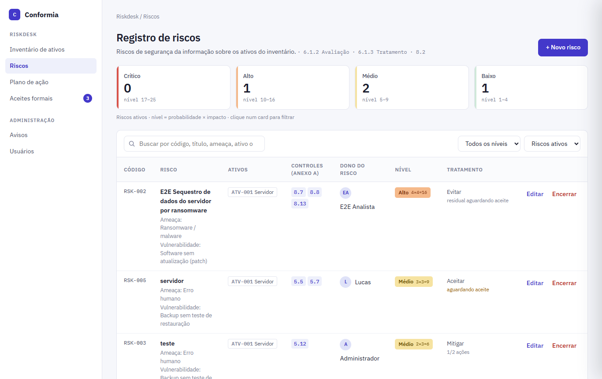 | 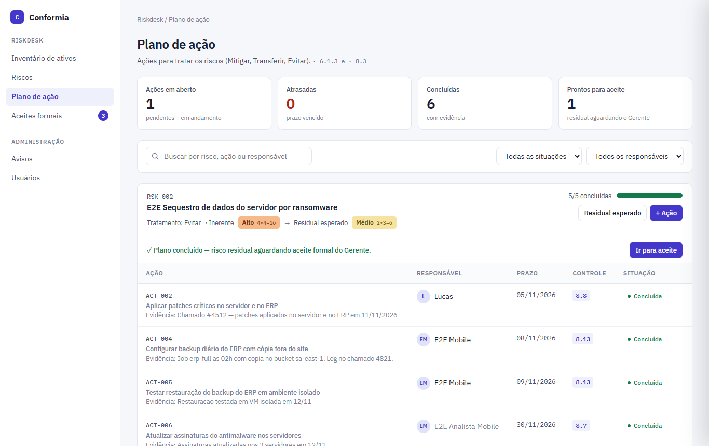 |
| **Aceites formais** | **Inventário de ativos** |
| 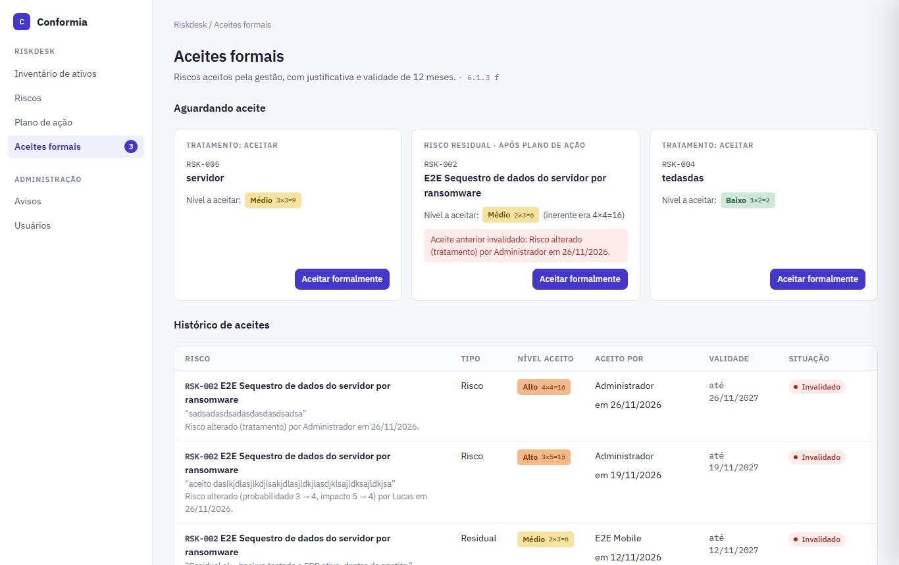 | 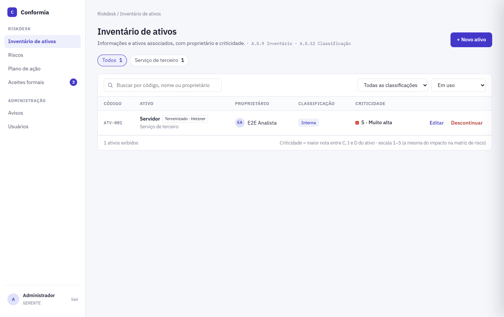 |
| **Avisos** | **Login** |
| 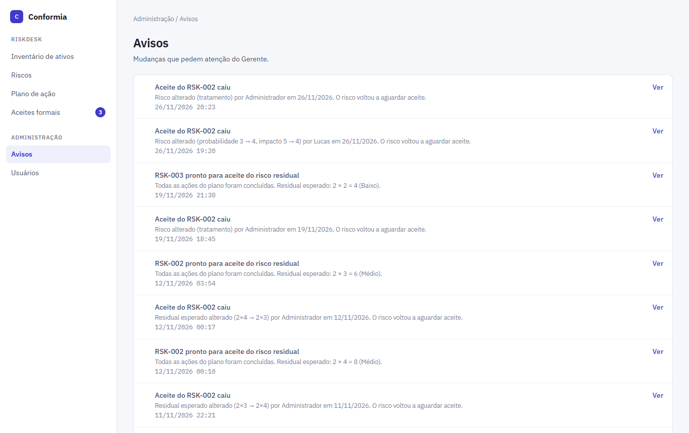 | 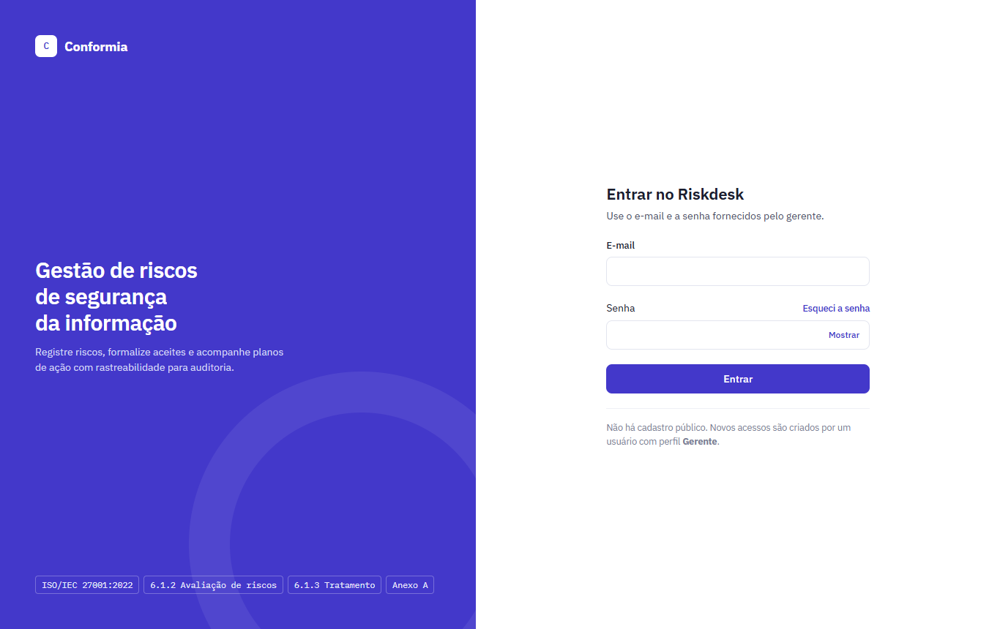 |

### App Android

| Riscos | Detalhe do risco | Aceites | Aceite formal |
| --- | --- | --- | --- |
| 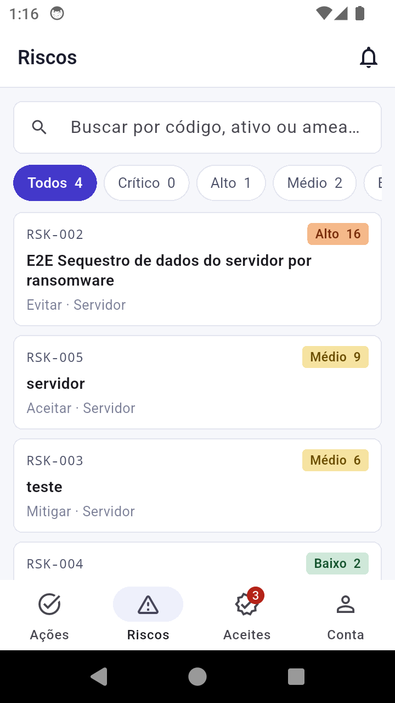 | 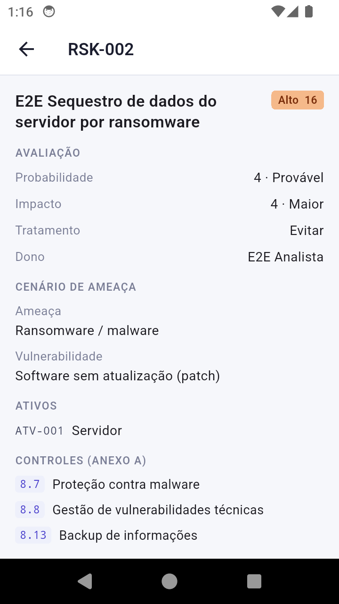 | 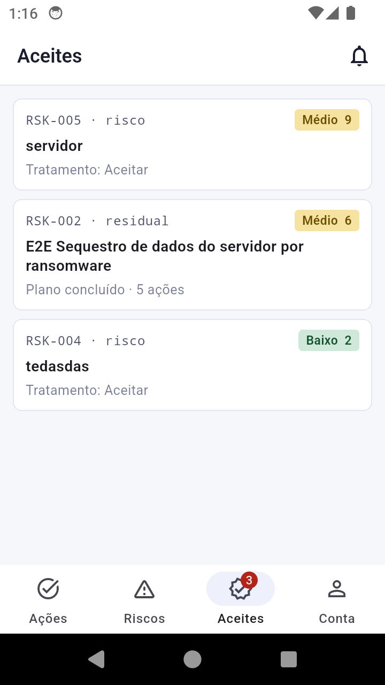 | 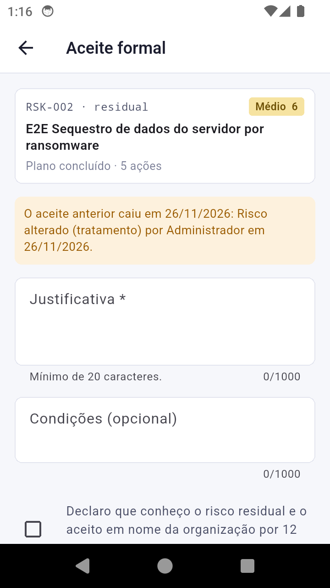 |
| **Minhas ações** | **Avisos** | **Conta** | |
| 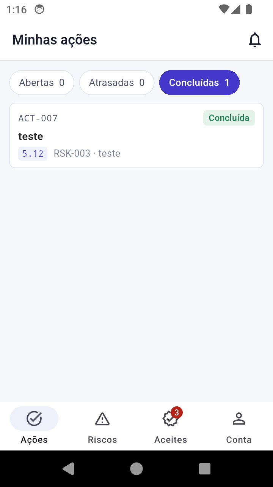 | 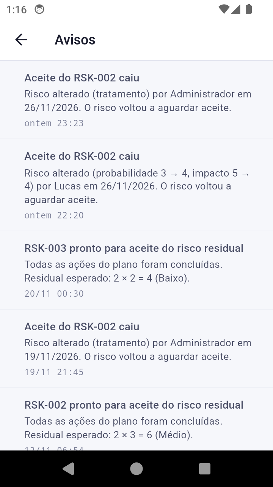 | 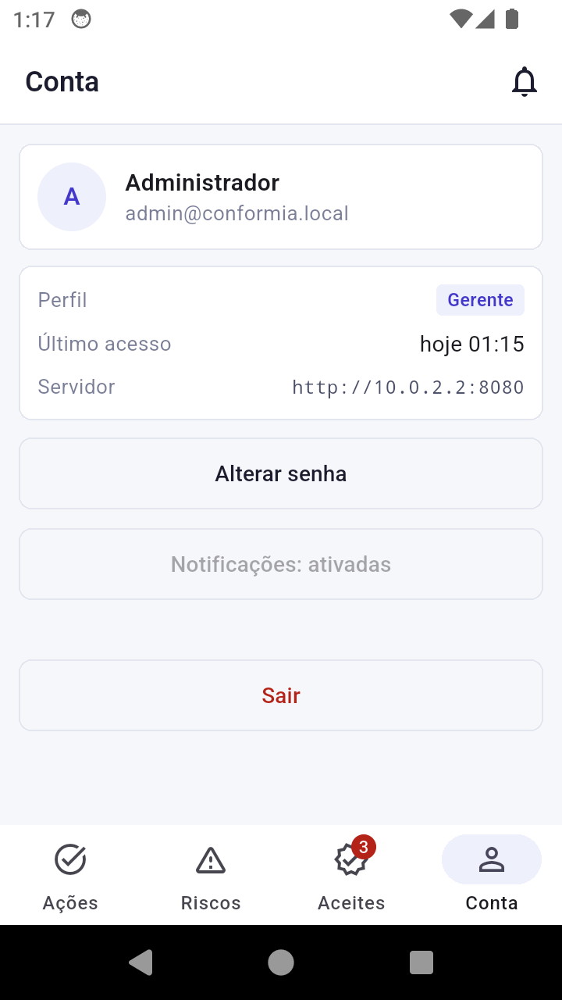 | |

Vídeo navegando pelo app: [docs/img/mobile-demo.mp4](docs/img/mobile-demo.mp4)

## Tecnologias

| Parte | Tecnologias |
| --- | --- |
| Servidor e web | Java 21, Spring Boot 4.1, Spring MVC, Thymeleaf, Spring Security, Spring Data JPA (Hibernate), Bean Validation |
| Banco | PostgreSQL + Flyway (migrations versionadas) |
| App | Flutter (Dart), Riverpod, Dio, WorkManager, flutter_local_notifications |
| Testes | JUnit 5, Mockito, AssertJ, `@SpringBootTest`; `flutter test` |
| Build | Maven (wrapper `mvnw`) e Gradle (Android) |

## Arquitetura

Monólito em **3 camadas**, organizado **por módulo** de negócio. O navegador fala com os controllers `web/` (telas Thymeleaf) e o app com os controllers `api/` (JSON em `/api/**`). Os dois chamam o **mesmo `service/`**, então a regra de negócio nunca fica duplicada.

```
Navegador ──HTML──> web/  (@Controller)     ┐
                                             ├──> service/ ──> repository/ ──> PostgreSQL
App Flutter ─JSON─> api/  (@RestController)  ┘     (regras)     (Spring Data JPA)
```

- Login por **sessão** (cookie `JSESSIONID`) na web e no app, sem JWT: logout e bloqueio de usuário valem na hora.
- Permissões por perfil no Spring Security: Auditor só lê, alterações exigem Gerente ou Analista, aceite só Gerente.
- Notificações do app **sem Firebase**: o app consulta `/api/avisos` a cada 1 min aberto e a cada 15 min fechado (WorkManager).

## Estrutura do repositório

```
Conformia/
├─ server/   Spring Boot: telas web, API do app, regras e banco
│  └─ src/main/java/.../conformia/<modulo>/{domain,repository,service,dto,web,api}
│  └─ src/main/resources/db/migration   migrations Flyway (V1 a V4)
├─ mobile/   App Flutter (lib/<modulo>/: tela, provider e modelo)
└─ docs/     contrato da API (docs/api) e imagens (docs/img)
```

## Como rodar

**Pré-requisitos:** Java 21, PostgreSQL, Flutter e Android Studio (para o emulador).

### 1. Banco

Crie no PostgreSQL um usuário da aplicação e os bancos `conformia` e `conformia_test`. As tabelas são criadas pelo Flyway quando o servidor sobe.

### 2. Servidor e web

```bash
cd server
cp .env.example .env    # preencha DB_USER, DB_PASS e os dados do usuário inicial
./mvnw spring-boot:run  # no Windows: .\mvnw.cmd spring-boot:run
```

Acesse `http://localhost:8080`. O primeiro login usa o e-mail e a senha de `ADMIN_EMAIL` / `ADMIN_SENHA` do `.env`, com troca obrigatória da senha.

### 3. App Android

Com o servidor rodando e um emulador aberto:

```bash
cd mobile
flutter pub get
flutter run -d emulator-5554
```

No emulador, o app usa `http://10.0.2.2:8080` (o localhost do PC). Num celular na mesma rede: `flutter run --dart-define=API_URL=http://<IP-do-PC>:8080`.

## Testes

```bash
cd server && ./mvnw verify   # unitários (*Test) e integração (*IT, banco conformia_test)
cd mobile && flutter test    # unitários do app
```

Os testes seguem o padrão **AAA** (Arrange, Act, Assert). Os unitários testam os `service/` com Mockito, sem subir o Spring; os de integração sobem a aplicação e chamam as URLs da web e da API.

## Documentação

- Contrato da API do app: [docs/api](docs/api)
- Detalhes do app mobile: [mobile/README.md](mobile/README.md)
